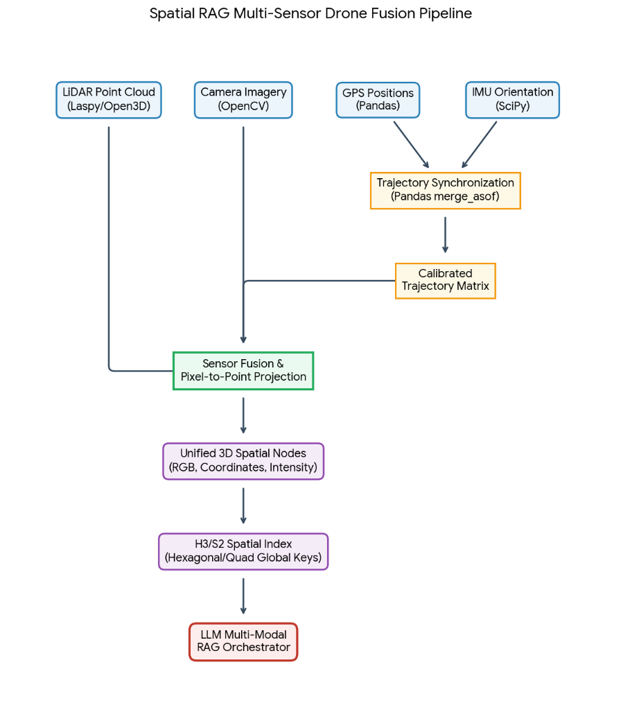

# Spatial RAG & Autonomous Drone Inspection Architecture

A comprehensive technical blueprint for autonomous linear asset inspection (e.g. freight trains, railways, industrial facilities) bridging multi-sensor fusion, Spatial RAG indexing, multimodal AI reasoning, and deterministic flight safety.

---

## 1. System Mission & Core Principle

> **Core Objective:** Enable an operator to command a drone in plain English (or via a rough hand-drawn sketch) to autonomously inspect a complex 3D asset (like a 600m freight train), with mathematical guarantees that the drone will never collide with obstacles, wires, or people.

### The Golden Separation of Concerns
1. **The Intelligence Layer (Probabilistic AI - Claude / Gemini):**
   - Natural language intent parsing, semantic target identification (locomotives, bogies, couplings, pantographs).
   - Translates prompts into candidate 3D trajectories (Waypoints, Standoff Distance, Gimbal Angles).
2. **The Safety & Validation Layer (Deterministic Zero-AI - SPIR / C++):**
   - Ray-casting polygon geofences, minimum proximity bubbles (LiDAR distance $< 2.0\text{m}$ = instant brake).
   - Fast-forward headless physics simulation (Gazebo / Isaac Sim) validating the flight in 3 seconds before physical takeoff.
3. **The Flight Execution Layer (DJI Autopilot / MAVLink):**
   - Receives compiled **WPML (Waypoint Markup Language)** files.
   - Handles motor balancing (500 Hz), wind stabilization, and real-time APAS obstacle bypass.

---

## 2. Multi-Sensor Drone Fusion Pipeline



### The 4 Sensor Streams:
- **LiDAR (`laspy` / `Open3D`):** High-density $(X, Y, Z)$ spatial depth points + laser reflectivity intensity.
- **Camera (`OpenCV`):** High-resolution RGB frames with millisecond camera shutter timestamps.
- **RTK-GPS (`Pandas`):** Centimeter-level global coordinates (Latitude, Longitude, Altitude ASL/WGS84).
- **IMU Orientation (`SciPy`):** High-frequency (200 Hz) Gyro/Accelerometer quaternions (Roll, Pitch, Yaw).

### Sensor Synchronization (`pandas.merge_asof`):
Because sensors emit data at mismatched frequencies (IMU: 200 Hz, Camera: 30 Hz, LiDAR: 20 Hz, GPS: 10 Hz), `pandas.merge_asof` performs backward/nearest temporal matching within a configurable tolerance ($\le 5\text{ms}$), generating a unified **Calibrated Trajectory Matrix** for every single frame and laser pulse.

### Pixel-to-Point Projection:
Using the camera intrinsic matrix $K$ and extrinsic matrix $[R | T]$ from the calibrated trajectory:
- Every 3D laser point is mapped to its exact 2D camera pixel.
- Outputs **Unified 3D Spatial Nodes**: `[X, Y, Z, R, G, B, Intensity, Timestamp]`.

---

## 3. Spatial RAG & Global Indexing (H3 / S2)

### The Problem it Solves
A raw 2cm accurate LiDAR scan of a 500-meter train contains **30+ million points (~800 MB)**. Feeding this directly into an LLM exceeds context limits and causes latency lag.

### The Solution: Hexagonal Spatial Chunking (Uber H3 / Google S2)
- The physical environment is partitioned into discrete global hexagonal/quad cells.
- Each H3 cell indexes:
  - Bounding geometry and surface normals.
  - Semantic object classification (e.g. `car_type: tanker`, `component: bogie_left`).
  - High-res photo references and laser height clearances.
- When an operator prompts: *"Inspect the wheels of Car 4"*, the RAG orchestrator queries **only the H3 cell IDs corresponding to Car 4** (a few kilobytes of structured JSON), enabling instantaneous reasoning with zero context overload.

---

## 4. Site-Specific Spatial Memory (Platform / Yard RAG)

When scanning 5 to 6 different trains at the same railway platform over time, the Spatial RAG splits into two permanent knowledge tiers:

### 1. Static Yard Anchors (Permanent Infrastructure)
- Track centerline GPS.
- High-voltage overhead catenary wire height (e.g. fixed at $7.15\text{m}$).
- Platform lighting poles, station roof overhangs, and signals.
- **Benefit:** Hazards are mapped once and permanently locked. The drone never flies blind or rediscovers fixed obstacles.

### 2. Train Variation Library (Dynamic Rakes)
- Scan 1: High-cube Container Freight
- Scan 2: Cylindrical Oil Tanker
- Scan 3: Open Coal Hopper
- Scan 4: Passenger Coach
- **Benefit:** When a new train arrives, Claude instantly matches its visual silhouette to the closest RAG template, stretches the path to match the car count, and outputs an approved WPML mission in **under 2 seconds**.

---

## 5. From Human Rough Pass to Precision Autonomous Flight

### Trajectory Learning from Demonstration (Spline Extrapolation)
1. **The Human Survey Pass:** The pilot flies roughly and loosely over the train at 2 to 3 altitudes (Top-down at 15m, Oblique at 8m, Low flank at 3.5m).
2. **True Spine Extraction:** The computer calculates the train surface directly:
   $$\vec{S}(t) = \vec{P}_{\text{drone}}(t) + \vec{D}_{\text{lidar}}(t)$$
   Filtering out human hand wobbles and wind drifts.
3. **B-Spline Offsetting:** The system fits a smooth cubic spline through $\vec{S}(t)$ and calculates exact parallel offsets:
   - Left Flank: $\vec{S}(s) + 4.0\vec{N}_{\text{left}}$
   - Right Flank: $\vec{S}(s) + 4.0\vec{N}_{\text{right}}$
   - Caboose Arc: Smooth $180^\circ$ circular curve with $5.0\text{m}$ radius.

---

## 6. Real-Time Obstacle Bypass Without Companion Computers (No Jetson Needed)

To minimize per-drone costs and maximize battery flight time, the system does not require a \$1,000 NVIDIA Jetson mounted on every drone:

### 1. Native DJI APAS 5.0 Bypass
- Enterprise DJI drones (e.g. Mavic 3 Enterprise / Matrice 350) have dedicated onboard vision processors.
- With **APAS Bypass** enabled, if a worker or equipment appears in the flight corridor, the drone's internal firmware automatically curves around or climbs over them and resumes the WPML track.

### 2. Dynamic Time-Stamped Checkpoint Pop-Up ("The Elevator")
If managed via the DERYK Ground App over radio telemetry:
1. **Trigger:** Front sensor reports obstacle $< 3.0\text{m}$.
2. **Pause & Store:** System records checkpoint `[Waypoint 14, Alt 2.5m, Time T]`.
3. **Climb (+2.5m):** Drone ascends to $5.0\text{m}$ (clearing over the human's head).
4. **Traverse:** Flies forward horizontally across the clearance window.
5. **Descend & Resume:** Drops back to $2.5\text{m}$ and resumes Waypoint 15.

---

## 7. Architecture Summary & Data Flow

```text
[ Raw Sensors: LiDAR + Camera + GPS + IMU ]
                      │
                      ▼ (pandas.merge_asof)
         [ Calibrated Trajectory Matrix ]
                      │
                      ▼ (Pixel-to-Point)
          [ Unified 3D Spatial Nodes ]
                      │
                      ▼ (Scan-to-CAD)
[ Clean .step Mesh + Ground Plane Z=0 + Geo-Anchor ]
                      │
                      ▼
         [ H3/S2 Spatial RAG Storage ]
                      │
    ┌─────────────────┴─────────────────┐
    ▼                                   ▼
[ Operator Prompt / Tablet Sketch ]   [ Site Memory (Fixed Wire Hazards) ]
    │                                   │
    └─────────────────┬─────────────────┘
                      ▼
        [ Claude / Gemini Orchestrator ]
                      │
                      ▼ (Generates Path)
           [ Candidate 3D WPML File ]
                      │
                      ▼ (Headless Sim in Gazebo / Fast-Forward 3s)
        [ Deterministic Safety Gate (SPIR C++) ]
                      │
             ┌────────┴────────┐
             ▼                 ▼
         [ PASS ]           [ FAIL ]
             │                 └── Re-plan with offset
             ▼
  [ DJI Enterprise Flight Controller ]
             │ (Flies WPML + APAS active)
             ▼
  [ Spaceborn-Management-System ]
  (Automated Defect & Flight Logs in Dashboard)
```

---

## 8. Directory & File Reference in Codebase

- **Mission Planning & LLM Agent:** [`MVP-1/backend/api/agents/`](file:///c:/Users/hp/Documents/antigravity/modest-planck/Spaceborn-Management-System/)
- **World State & Predictive Model:** [`MVP-2/api/world_state.py`](file:///c:/Users/hp/Documents/antigravity/modest-planck/Spaceborn-Management-System/)
- **Vision Pipeline (RT-DETR-L):** [`MVP-3/perception/vision/`](file:///c:/Users/hp/Documents/antigravity/modest-planck/Spaceborn-Management-System/)
- **Deterministic C++ Runtime & FSM:** [`SPIR/spir_runtime/safety/geofence_validator.hpp`](file:///c:/Users/hp/Documents/antigravity/modest-planck/Spaceborn-Management-System/) & `SPIR/mission_runtime/inc/fsm.h`
- **Gazebo / ROS 2 Sim:** [`DERYK-AIE/DERYK_Week1_Handoff/`](file:///c:/Users/hp/Documents/antigravity/modest-planck/Spaceborn-Management-System/)
- **3D World Interactive Simulator:** [`docs/3d_world_digital_twin.html`](./3d_world_digital_twin.html)
- **Fleet & Operations Management:** [`Spaceborn-Management-System/`](file:///c:/Users/hp/Documents/antigravity/modest-planck/Spaceborn-Management-System/)
